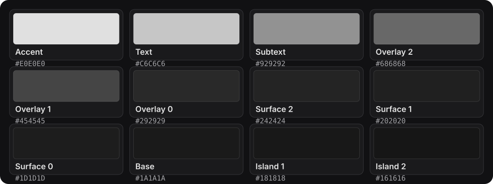
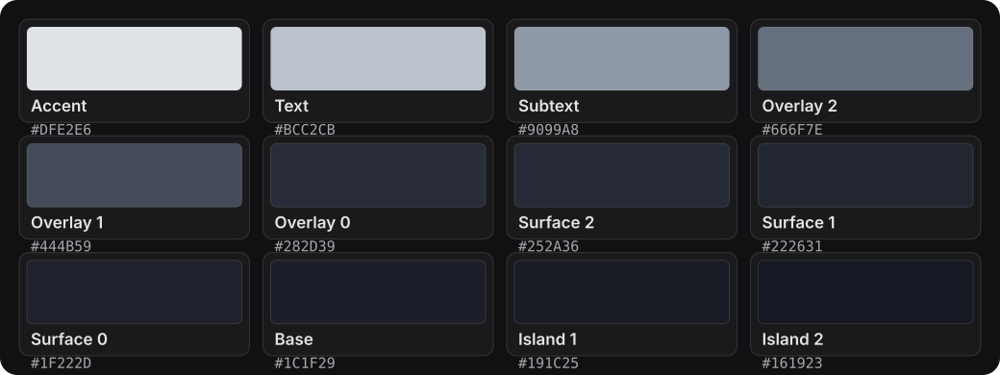
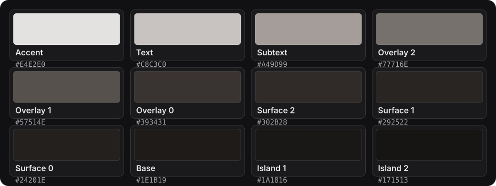

# MonoYou Colors

The foundation of the **MonoYou** color system.

MonoYou Colors defines a restrained monochromatic palette system designed to keep visual consistency across desktop environments and applications.

The project currently provides three variants: **Neutral**, **Cold**, and **Warm**. Each variant uses the same twelve semantic color roles.

## Palettes

### MonoYou — Neutral

The original monochromatic palette, built around neutral grayscale tones.



### MonoYou Cold

A cool variation with subtle blue-gray undertones.



### MonoYou Warm

A warm variation with subtle warm-gray and charcoal undertones.



## Color roles

| Color | Purpose |
|---|---|
| `accent` | Highlights, active elements, focus indicators, and emphasis. |
| `text` | Primary text and content. |
| `subtext` | Secondary text and supporting information. |
| `overlay2` | Stronger overlay elements. |
| `overlay1` | Intermediate overlay elements. |
| `overlay0` | Subtle overlay elements. |
| `surface2` | Higher-level surface elements. |
| `surface1` | Intermediate surface elements. |
| `surface0` | Base-level surface elements. |
| `base` | Primary background color. |
| `island1` | Darker separated areas. |
| `island2` | Deepest separated areas. |

## Repository structure

```text
monoyou-colors/
├── assets/
│   └── palettes/
│       ├── neutral.svg
│       ├── cold.svg
│       └── warm.svg
├── docs/
├── palettes/
│   ├── neutral/
│   │   └── palette.yaml
│   ├── cold/
│   │   └── palette.yaml
│   └── warm/
│       └── palette.yaml
├── scripts/
├── LICENSE
└── README.md
```

## Design principles

- **Monochromatic:** Each variant follows a restrained color direction.
- **Consistency:** All variants share the same semantic color structure.
- **Separation of concerns:** Color definitions are independent of their implementations.
- **Flexibility:** Palettes can evolve without changing the structure consumed by applications.

## Related projects

MonoYou Colors is the foundation for the broader MonoYou ecosystem:

- **MonoYou Plasma** — KDE Plasma and Qt integration.
- **MonoYou GTK** — GTK 3 and GTK 4 integration.

## License

See [LICENSE](LICENSE) for licensing information.
