# MonoYou Colors

The foundation of the **MonoYou** color system.

MonoYou Colors defines a restrained monochromatic palette system designed to keep visual consistency across desktop environments and applications.

The project currently provides three variants: **Cold**, **Neutral** and **Warm**. Each variant uses the same twelve semantic color roles.

<table align="center">
  <tr>
    <td align="center">
      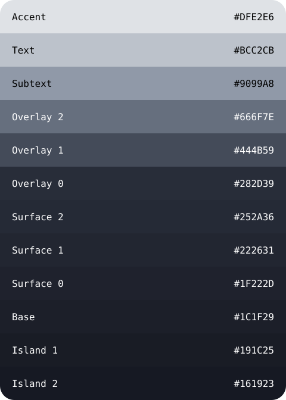<br>
      <sub><b>Cold</b></sub>
    </td>
    <td align="center">
      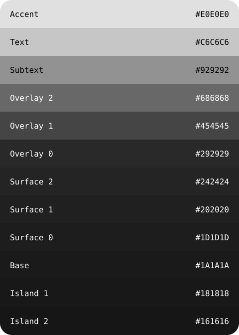<br>
      <sub><b>Neutral</b></sub>
    </td>
    <td align="center">
      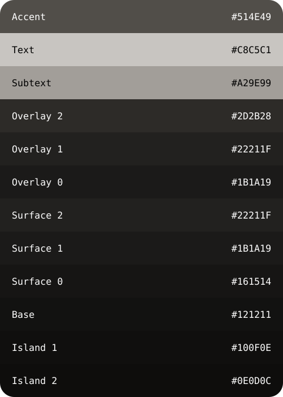<br>
      <sub><b>Warm</b></sub>
    </td>
  </tr>
</table>

## Palettes

### MonoYou — Neutral

The original monochromatic palette, built around neutral grayscale tones.

| Color | Swatch | HEX | RGB | HSL |
|---|---|---|---|---|
| Accent | 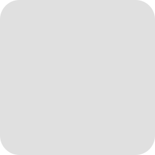 | `#E0E0E0` | `224, 224, 224` | `0°, 0%, 88%` |
| Text | 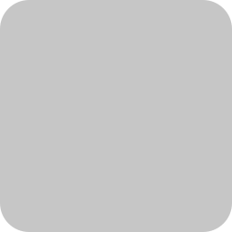 | `#C6C6C6` | `198, 198, 198` | `0°, 0%, 78%` |
| Subtext | 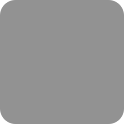 | `#929292` | `146, 146, 146` | `0°, 0%, 57%` |
| Overlay 2 | 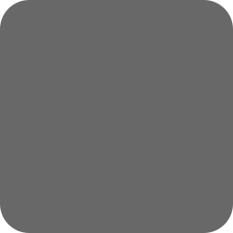 | `#686868` | `104, 104, 104` | `0°, 0%, 41%` |
| Overlay 1 | 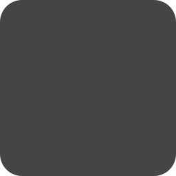 | `#454545` | `69, 69, 69` | `0°, 0%, 27%` |
| Overlay 0 |  | `#292929` | `41, 41, 41` | `0°, 0%, 16%` |
| Surface 2 |  | `#242424` | `36, 36, 36` | `0°, 0%, 14%` |
| Surface 1 |  | `#202020` | `32, 32, 32` | `0°, 0%, 13%` |
| Surface 0 |  | `#1D1D1D` | `29, 29, 29` | `0°, 0%, 11%` |
| Base |  | `#1A1A1A` | `26, 26, 26` | `0°, 0%, 10%` |
| Island 1 |  | `#181818` | `24, 24, 24` | `0°, 0%, 9%` |
| Island 2 |  | `#161616` | `22, 22, 22` | `0°, 0%, 9%` |

### MonoYou Cold

A cool variation with subtle blue-gray undertones.

| Color | Swatch | HEX | RGB | HSL |
|---|---|---|---|---|
| Accent | 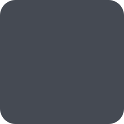 | `#DFE2E6` | `223, 226, 230` | `214°, 12%, 89%` |
| Text | 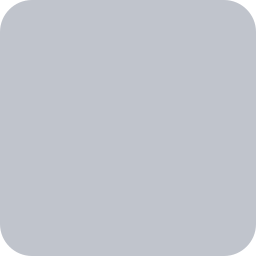 | `#BCC2CB` | `188, 194, 203` | `216°, 13%, 77%` |
| Subtext | 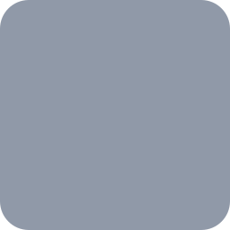 | `#9099A8` | `144, 153, 168` | `218°, 12%, 61%` |
| Overlay 2 | 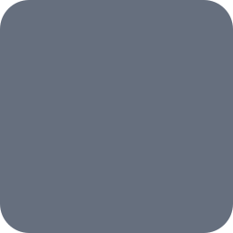 | `#666F7E` | `102, 111, 126` | `218°, 11%, 45%` |
| Overlay 1 |  | `#444B59` | `68, 75, 89` | `220°, 13%, 31%` |
| Overlay 0 |  | `#282D39` | `40, 45, 57` | `222°, 18%, 19%` |
| Surface 2 |  | `#252A36` | `37, 42, 54` | `222°, 19%, 18%` |
| Surface 1 |  | `#222631` | `34, 38, 49` | `224°, 18%, 16%` |
| Surface 0 |  | `#1F222D` | `31, 34, 45` | `227°, 18%, 15%` |
| Base |  | `#1C1F29` | `28, 31, 41` | `226°, 19%, 14%` |
| Island 1 |  | `#191C25` | `25, 28, 37` | `225°, 19%, 12%` |
| Island 2 |  | `#161923` | `22, 25, 35` | `226°, 23%, 11%` |

### MonoYou Warm

A warm variation with subtle warm-gray and charcoal undertones.

| Color | Swatch | HEX | RGB | HSL |
|---|---|---|---|---|
| Accent | 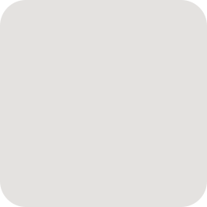 | `#E4E2E0` | `228, 226, 224` | `30°, 7%, 89%` |
| Text | 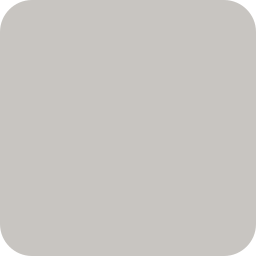 | `#C8C3C0` | `200, 195, 192` | `22°, 7%, 77%` |
| Subtext | 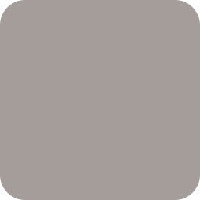 | `#A49D99` | `164, 157, 153` | `22°, 6%, 62%` |
| Overlay 2 |  | `#77716E` | `119, 113, 110` | `20°, 4%, 45%` |
| Overlay 1 |  | `#57514E` | `87, 81, 78` | `20°, 5%, 32%` |
| Overlay 0 |  | `#393431` | `57, 52, 49` | `22°, 8%, 21%` |
| Surface 2 |  | `#302B28` | `48, 43, 40` | `23°, 9%, 17%` |
| Surface 1 |  | `#292522` | `41, 37, 34` | `26°, 9%, 15%` |
| Surface 0 |  | `#24201E` | `36, 32, 30` | `20°, 9%, 13%` |
| Base |  | `#1E1B19` | `30, 27, 25` | `24°, 9%, 11%` |
| Island 1 |  | `#1A1816` | `26, 24, 22` | `30°, 8%, 9%` |
| Island 2 |  | `#171513` | `23, 21, 19` | `30°, 10%, 8%` |

## Color roles

| Color | Purpose |
|---|---|
| `accent` | Highlights, active elements, focus indicators, and emphasis. |
| `text` | Primary text and content. |
| `subtext` | Secondary text and supporting information. |
| `overlay2` | Stronger overlay elements. |
| `overlay1` | Intermediate overlay elements. |
| `overlay0` | Subtle overlay elements. |
| `surface2` | Higher-level surface elements. |
| `surface1` | Intermediate surface elements. |
| `surface0` | Base-level surface elements. |
| `base` | Primary background color. |
| `island1` | Darker separated areas. |
| `island2` | Deepest separated areas. |

## Repository structure

```text
monoyou-colors/
├── assets/
│   └── palettes/
│       ├── neutral/
│       │   └── ...
│       ├── cold/
│       │   └── ...
│       └── warm/
│           └── ...
├── palettes/
│   ├── neutral/
│   │   └── palette.yaml
│   ├── cold/
│   │   └── palette.yaml
│   └── warm/
│       └── palette.yaml
├── LICENSE
└── README.md
```

## Design principles

- **Monochromatic:** Each variant follows a restrained color direction.
- **Consistency:** All variants share the same semantic color structure.
- **Separation of concerns:** Color definitions are independent of their implementations.
- **Flexibility:** Palettes can evolve without changing the structure consumed by applications.

## Related projects

MonoYou Colors is the foundation for the broader MonoYou ecosystem:

- [**MonoYou Plasma**](https://github.com/edwardzerov2/monoyou-plasma) — KDE Plasma and Qt integration.
- [**MonoYou GTK**](https://github.com/edwardzerov2/monoyou-gtk) — GTK 3 and GTK 4 integration.

## License

See [LICENSE](LICENSE) for licensing information.
